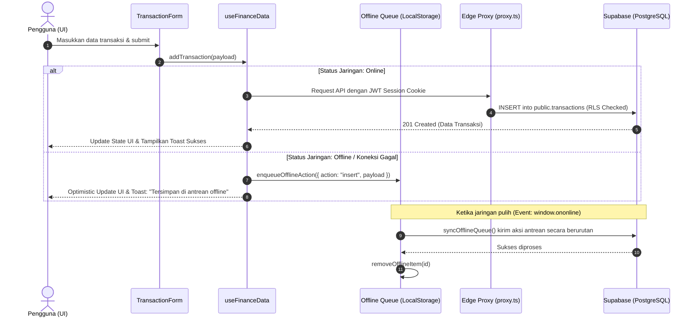

# Cukupin API, Data Lifecycle & State Architecture

Dokumentasi alur data menyeluruh (End-to-End Data Flow), arsitektur sinkronisasi *Offline-First*, format data cadangan v2.0, serta spesifikasi impor/ekspor CSV pada aplikasi Cukupin.

---

## 1. Diagram Alur Data Menyeluruh (Lifecycle Flow)



---

## 2. Arsitektur State & Reaktivitas Data

### 2.1. `context/FinanceContext.tsx` & `hooks/useFinanceData.ts`
Aplikasi menggunakan **Single Source of Truth** yang terdistribusi melalui Context API:

- **State yang Dikelola**:
  - `transactions`: Array mutasi harian.
  - `goals`: Array target tabungan.
  - `wishlist`: Array daftar keinginan.
  - `recurringBills`: Array tagihan rutin bulanan/tahunan.
  - `categoryBudgets`: Array batas pengeluaran kategori.
  - `loading`: Flag status pengambilan data awal.
  - `activeMonth`: Filter bulan aktif untuk laporan (`YYYY-MM`).
- **Reaktivitas Real-Time**:
  Ketika klien terhubung, `useFinanceData` membuka saluran WebSocket melalui Supabase Realtime:
  ```typescript
  const channel = supabase
    .channel('cukupin-changes')
    .on('postgres_changes', { event: '*', schema: 'public' }, () => {
      refreshData();
    })
    .subscribe();
  ```
  Setiap perubahan data dari perangkat lain (misal via smartphone atau tab browser lain) otomatis menyegarkan antarmuka secara instan tanpa perlu reload.

---

## 3. Sistem Antrean Offline-First (`lib/offlineQueue.ts`)

Untuk menjamin keandalan saat pengguna berada di daerah minim sinyal, seluruh aksi penulisan dibekali fallback antrean offline:

### Struktur Item Antrean
```typescript
interface OfflineQueueItem {
  id: string;              // Unique identifier antrean (timestamp-based)
  userId: string;          // User ID pemilik aksi
  action: 'insert' | 'update' | 'delete';
  table?: 'transactions' | 'saving_goals' | 'wishlist' | 'recurring_bills' | 'category_budgets';
  targetId?: string;       // ID record target (untuk update & delete)
  payload?: any;           // Data mutasi
  timestamp: number;       // Waktu saat aksi dicatat secara lokal
  retryCount: number;      // Jumlah percobaan ulang sinkronisasi
}
```

### Mekanisme Sinkronisasi Otomatis
1. **Pemicu Event**:
   - Event peramban `window.addEventListener('online', ...)`
   - Panggilan saat inisialisasi awal aplikasi (`AppShell` mount).
2. **Penanganan Skema Usang (Schema Resilience)**:
   Jika database remote belum menjalankan migrasi kolom terbaru (misal `payment_method`), `offlineQueue` secara cerdas mengabungkan data tersebut ke dalam field `note` (`[Metode: BCA]`) dan mencoba kembali secara otomatis tanpa membuat antrean macet.

---

## 4. Spesifikasi Cadangan Data Standar v2.0 (`lib/backup.ts`)

Cukupin menggunakan format berkas JSON v2.0 yang divalidasi ketat menggunakan pustaka **Zod** (`backupPayloadSchema`):

```json
{
  "version": "2.0",
  "exported_at": "2026-09-07T12:00:00.000Z",
  "app": "Cukupin",
  "record_counts": {
    "transactions": 45,
    "saving_goals": 3,
    "wishlist": 5,
    "recurring_bills": 2,
    "category_budgets": 4
  },
  "data": {
    "transactions": [...],
    "saving_goals": [...],
    "wishlist": [...],
    "recurring_bills": [...],
    "category_budgets": [...]
  }
}
```

### Pencegahan Kebocoran Memori (Memory Leak Prevention)
Saat proses unduh berkas JSON atau ekspor CSV dijalankan di peramban, URL objek memori langsung dibebaskan:
```typescript
const url = URL.createObjectURL(blob);
// Eksekusi trigger download <a href=url download=filename>
URL.revokeObjectURL(url); // Mencegah memory leak pada sesi SPA yang panjang
```

---

## 5. Protokol Impor & Ekspor CSV

### 5.1. Format Standar Ekspor CSV
File CSV menggunakan pemisah koma (`,`) dengan encoding UTF-8 dan header standar:
```csv
Tanggal,Tipe,Kategori,Deskripsi,Jumlah,Metode Bayar,Catatan
2026-09-07,expense,Food,Makan Siang Nasi Padang,35000,Tunai / Cash,Bareng rekan kerja
2026-09-05,income,Salary,Gaji Bulanan,8500000,Transfer Bank,Transfer payroll
```

### 5.2. Parser Impor CSV Cerdas (`CsvImportModal.tsx`)
- Mampu mendeteksi secara otomatis pemisah koma (`,`) maupun titik koma (`;`) yang lazim digunakan pada Excel versi bahasa Indonesia.
- Mendukung pemetaan header fleksibel (misal: "Nominal", "Harga", atau "Amount" otomatis dipetakan ke kolom `amount`).
- Melakukan pembersihan format angka Rupiah (mengabaikan titik ribuan `.` dan simbol `Rp`).
- Menampilkan jendela pratinjau (*Live Preview Table*) sebelum data disimpan permanen ke basis data.
