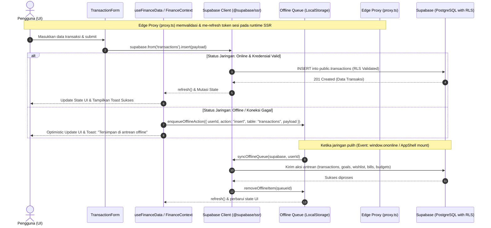

# Cukupin™ API, Data Lifecycle & State Architecture

Dokumentasi alur data menyeluruh (End-to-End Data Flow), arsitektur sinkronisasi *Offline-First*, format data cadangan v2.0, serta spesifikasi impor/ekspor CSV pada aplikasi Cukupin™.

---

## 1. Diagram Alur Data Menyeluruh (Lifecycle Flow)



---

## 2. Arsitektur State & Reaktivitas Data

### 2.1. `context/FinanceContext.tsx` & `hooks/useFinanceData.ts`
Aplikasi menggunakan **Single Source of Truth** yang terdistribusi melalui Context API:

- **State yang Dikelola**:
  - `transactions`: Array mutasi harian (`Transaction[]`).
  - `goals`: Array target tabungan (`SavingGoal[]`).
  - `wishlist`: Array daftar impian (`WishlistItem[]`).
  - `bills`: Array tagihan rutin bulanan/tahunan (`RecurringBill[]`).
  - `budgets`: Array batas pengeluaran kategori (`CategoryBudget[]`).
  - `loading`: Flag status pengambilan data awal.
  - `refresh`: Fungsi pembaruan data asinkron (`() => Promise<void>`).
  - `setTransactions`, `setGoals`, `setWishlist`, `setBills`, `setBudgets`: Setter fungsi state.
  - `logRecurringBillAsTransaction`: Fungsi satu klik untuk mencatat tagihan ke transaksi.
  *(Catatan: Filter bulan aktif `activeMonth` dikelola secara lokal pada komponen tampilan seperti `ReportsView` dan `MonthlyExpenseTemplate`)*.

- **Reaktivitas Real-Time Berbasis Pengguna**:
  Ketika terhubung ke Supabase, `useFinanceData` membuka saluran WebSocket khusus pengguna (`cukupin-${userId}`) dengan filter keamanan baris (`user_id=eq.${userId}`) pada setiap tabel:
  ```typescript
  const channel = supabase
    .channel(`cukupin-${userId}`)
    .on('postgres_changes', { event: '*', schema: 'public', table: 'transactions', filter: `user_id=eq.${userId}` }, refresh)
    .on('postgres_changes', { event: '*', schema: 'public', table: 'saving_goals', filter: `user_id=eq.${userId}` }, refresh)
    .on('postgres_changes', { event: '*', schema: 'public', table: 'wishlist', filter: `user_id=eq.${userId}` }, refresh)
    .on('postgres_changes', { event: '*', schema: 'public', table: 'recurring_bills', filter: `user_id=eq.${userId}` }, refresh)
    .on('postgres_changes', { event: '*', schema: 'public', table: 'category_budgets', filter: `user_id=eq.${userId}` }, refresh)
    .subscribe();
  ```
  Setiap perubahan data dari perangkat lain otomatis menyegarkan antarmuka secara instan tanpa perlu reload.

---

## 3. Sistem Antrean Offline-First (`lib/offlineQueue.ts`)

Untuk menjamin keandalan saat pengguna berada di daerah minim sinyal, seluruh aksi penulisan dibekali fallback antrean offline lokal (`cukupin_offline_queue`):

### Struktur Item Antrean (`QueuedAction`)
```typescript
export interface QueuedAction {
  queueId: string;         // Unique identifier antrean ('offline-' + timestamp + random)
  timestamp: number;       // Waktu saat aksi dicatat secara lokal
  userId: string;          // ID pengguna pemilik aksi
  action: 'insert' | 'update' | 'delete';
  table?: 'transactions' | 'saving_goals' | 'wishlist' | 'recurring_bills' | 'category_budgets';
  targetId?: string;       // ID record target (untuk update & delete)
  payload: any;            // Data mutasi yang akan dikirimkan
}
```

### Mekanisme Sinkronisasi Otomatis
1. **Pemicu Event**:
   - Event peramban `window.addEventListener('online', ...)`
   - Panggilan saat inisialisasi awal aplikasi (`AppShell` mount).
2. **Penanganan Skema Usang (Schema Resilience)**:
   Jika database remote belum menjalankan migrasi kolom terbaru (misal `payment_method`), `offlineQueue` secara cerdas menggabungkan data tersebut ke dalam field `note` (`[Metode: BCA]`) dan mencoba kembali secara otomatis tanpa membuat antrean macet.
3. **Pembersihan Antrean**:
   Item yang berhasil disinkronkan langsung dihapus dari antrean via `removeOfflineItem(queueId)`.

---

## 4. Spesifikasi Cadangan Data Standar v2.0 (`lib/backup.ts`)

Cukupin™ menggunakan format berkas JSON v2.0 dengan struktur *flat* yang divalidasi ketat menggunakan pustaka **Zod** (`backupPayloadSchema`):

```json
{
  "app": "cukupin",
  "version": "2.0",
  "exported_at": "2026-09-08T12:00:00.000Z",
  "record_counts": {
    "transactions": 45,
    "goals": 3,
    "wishlist": 5,
    "bills": 2,
    "budgets": 4
  },
  "transactions": [
    {
      "id": "tx-1",
      "user_id": "...",
      "type": "expense",
      "amount": 35000,
      "category": "Food",
      "description": "Makan Siang",
      "transaction_date": "2026-09-08",
      "payment_method": "QRIS",
      "note": null
    }
  ],
  "goals": [...],
  "wishlist": [...],
  "bills": [...],
  "budgets": [...]
}
```

### Pencegahan Kebocoran Memori (Memory Leak Prevention)
Saat proses unduh berkas JSON atau ekspor CSV dijalankan di peramban, URL objek memori langsung dibebaskan:
```typescript
const url = URL.createObjectURL(blob);
link.click();
setTimeout(() => {
  URL.revokeObjectURL(url); // Mencegah memory leak pada sesi SPA yang panjang
}, 150);
```

---

## 5. Protokol Impor & Ekspor CSV

### 5.1. Format Standar Ekspor CSV
File CSV menggunakan pemisah koma (`,`) dengan encoding UTF-8 (BOM `\uFEFF`) dan header standar:
```csv
Tanggal,Tipe,Kategori,Deskripsi,Jumlah,Metode Pembayaran,Catatan
2026-09-07,Pengeluaran,Food,Makan Siang Nasi Padang,35000,Tunai / Cash,Bareng rekan kerja
2026-09-05,Pemasukan,Salary,Gaji Bulanan,8500000,Transfer Bank,Transfer payroll
```

### 5.2. Parser Impor CSV Cerdas (`CsvImportModal.tsx`)
- Mampu mendeteksi secara otomatis pemisah koma (`,`) maupun titik koma (`;`) yang lazim digunakan pada Excel versi bahasa Indonesia.
- Mendukung pemetaan header fleksibel (misal: "Nominal", "Harga", atau "Amount" otomatis dipetakan ke kolom `amount`).
- Melakukan pembersihan format angka Rupiah (mengabaikan titik ribuan `.` dan simbol `Rp`).
- Menampilkan jendela pratinjau (*Live Preview Table*) sebelum data disimpan permanen ke basis data.
- **Offline & Local-Dev Fallback**: Mendukung penyimpanan langsung ke `cukupin_local_transactions` saat login sebagai `local-dev-user` atau saat jaringan offline.
