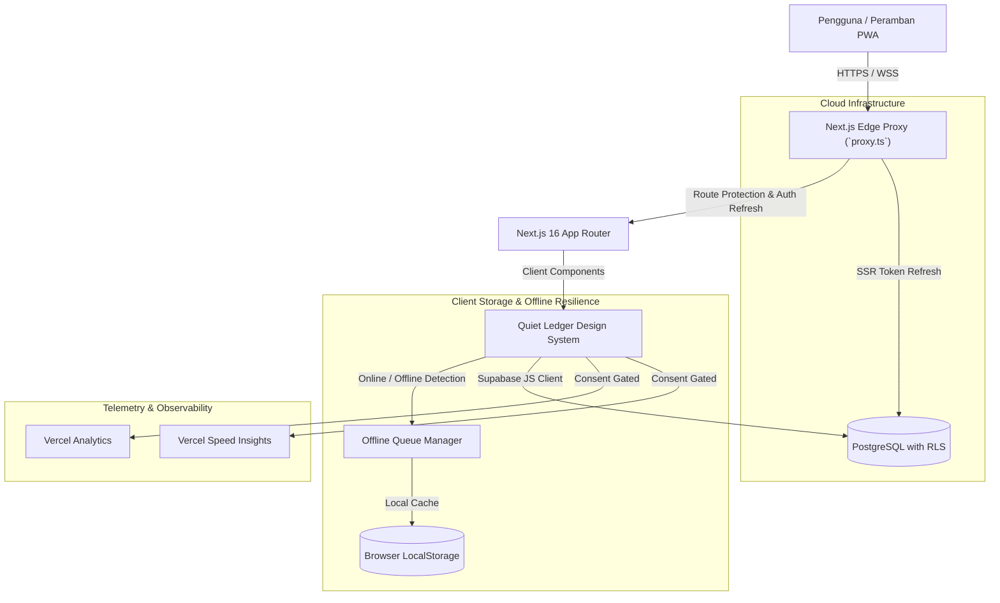

# Cukupin™: Technical Architecture & System Design Documentation

Dokumentasi arsitektur teknis, pola rekayasa perangkat lunak, dan infrastruktur data untuk aplikasi **Cukupin™**.

---

## 1. Ikhtisar Sistem (High-Level Architecture)

Cukupin™ dirancang menggunakan arsitektur modern berbasis **Next.js 16 (App Router)** dengan pendekatan *hybrid offline-first* dan integrasi cloud **Supabase (PostgreSQL)**.



---

## 2. Lapisan Keamanan & Edge Shielding (OWASP Standards)

### 2.1. HTTP Security Headers
Dikonfigurasi secara terpusat pada `next.config.mjs`:
- **Strict-Transport-Security (HSTS)**: `max-age=63072000; includeSubDomains; preload` (memaksa HTTPS selama 2 tahun).
- **Content-Security-Policy (CSP)**: Membatasi eksekusi skrip ke domain terpercaya (`'self'`, `'unsafe-inline'`, `https://va.vercel-scripts.com`, `https://vitals.vercel-insights.com`).
- **X-Frame-Options**: `DENY` untuk mencegah serangan Clickjacking.
- **X-Content-Type-Options**: `nosniff` untuk mencegah serangan MIME-type sniffing.
- **Referrer-Policy**: `strict-origin-when-cross-origin`.
- **Information Leakage**: `poweredByHeader: false` menghapus header identifikasi Next.js.

### 2.2. Edge Proxy Protection (`proxy.ts` - Next.js 16+ Convention)
- Memvalidasi dan memperbarui sesi autentikasi Supabase secara transparan pada edge runtime sebelum rute halaman dirender.
- Melindungi rute `/(protected)` (`/dashboard`, `/transactions`, `/reports`, `/goals`, `/wishlist`) dengan pengalihan otomatis ke `/auth/login` bagi pengguna tanpa sesi aktif.
- Menyediakan bypass otomatis untuk pengujian dan lingkungan pengembangan offline (`localhost`).

### 2.3. Sanitasi Injeksi Formula CSV (OWASP CSV Injection)
- Fungsi `escapeCsvField` pada `lib/finance.ts` menetralkan karakter berbahaya (`=`, `+`, `-`, `@`, `\t`, `\r`) dengan menyisipkan prefiks tanda kutip tunggal (`'`) sebelum diekspor.
- Ekspor menggunakan Byte Order Mark UTF-8 (`\uFEFF`) dan *blob URL* dengan pembersihan memori otomatis (`URL.revokeObjectURL`).

---

## 3. Infrastruktur Data & Disaster Recovery (Backup & Restore)

Cukupin™ menyediakan sistem pemulihan bencana terpusat pada `lib/backup.ts` untuk memastikan pengguna memiliki kendali penuh atas data mereka.

### 3.1. Spesifikasi Payload Cadangan v2.0
```typescript
interface BackupPayload {
  app: 'cukupin'
  version: '2.0'
  exported_at: string // ISO 8601
  record_counts: {
    transactions: number
    goals: number
    wishlist: number
    bills: number
    budgets: number
  }
  transactions: Transaction[]
  goals: SavingGoal[]
  wishlist: WishlistItem[]
  bills: RecurringBill[]
  budgets: CategoryBudget[]
}
```

### 3.2. Validasi Skema (Zod)
- Sebelum pemulihan data dilakukan, file JSON diverifikasi menggunakan Zod schema untuk memastikan tidak ada data korup atau manipulasi struktur.
- Mendukung kompatibilitas ke belakang (*backward compatibility*) dengan file cadangan versi v1.0.

### 3.3. Algoritma Pemulihan
- **Merge Mode**: Menggabungkan data cadangan dengan data yang sudah ada tanpa menimpa ID yang sama.
- **Replace Mode**: Mengosongkan data lama dan menggantikannya secara menyeluruh dengan data dari file cadangan.

---

## 4. Performa & Observabilitas (Web Vitals & Telemetry)

### 4.1. Code Splitting Dinamis
Komponen modal dan visualisasi berat dimuat secara dinamis melalui `next/dynamic`:
- `MonthlyExpenseTemplate` (ekspor PDF/CSV).
- `CsvImportModal` (pemrosesan file buku kas).
- `RestoreJsonModal` (pemulihan data).
- `FinancialWrappedModal` (generasi rapor grafis).
Hal ini mengurangi *First Contentful Paint (FCP)* dan *Total Blocking Time (TBT)* secara signifikan.

### 4.2. Render Memoization
- Komponen baris transaksi `TransactionRow` dioptimalkan dengan `React.memo`, mencegah render ulang beruntun pada daftar ribuan transaksi saat pengguna melakukan pencarian atau filter.

### 4.3. Pemantauan Web Vitals & Speed Insights
- `@vercel/speed-insights` terintegrasi bersama `@vercel/analytics`.
- **Privasi Terkendali (Consent-gated)**: Telemetri dan pelacakan performa otomatis dibatalkan (`return null` pada `beforeSend`) jika pengguna memilih opsi "Tolak" pada banner persetujuan cookie, mematuhi regulasi UU PDP No. 27/2022 dan GDPR.

---

## 5. Kepatuhan Hukum & Privasi Data

1. **Hak Penghapusan Data (Right to Erasure / UU PDP Pasal 39)**:
   - Fitur "Hapus Seluruh Data Keuangan" pada menu Transaksi memberikan fasilitas *hard-delete* dengan konfirmasi ganda pengetikan kata kunci `HAPUS`.
2. **Pembersihan Sesi Logout**:
   - Logout membersihkan antrean sinkronisasi offline (`cukupin_offline_queue`) dan token otorisasi dari `localStorage`.

---

## 6. Indeks Dokumentasi Sistem Lengkap

Untuk panduan mendalam lainnya, silakan merujuk ke pustaka dokumentasi resmi di folder `docs/`:
- 🗄️ [**DATABASE_SCHEMA.md**](./DATABASE_SCHEMA.md) — Diagram ERD, spesifikasi tabel, RLS, indeks performa, & publikasi realtime.
- 🔒 [**SECURITY_AUDIT.md**](./SECURITY_AUDIT.md) — Pemodelan ancaman (STRIDE), mitigasi OWASP Top 10, CSP, & kepatuhan UU PDP.
- 🔄 [**API_AND_DATA_FLOW.md**](./API_AND_DATA_FLOW.md) — Arsitektur alur data, antrean offline-first, backup payload v2.0, & pipeline CSV.
- 🛠️ [**DEVELOPER_GUIDE.md**](./DEVELOPER_GUIDE.md) — Panduan onboarding developer, setup lokal tanpa Supabase, TDD Vitest, & konvensi kode.
- 🚀 [**SUPABASE_DEPLOYMENT.md**](./SUPABASE_DEPLOYMENT.md) — Panduan migrasi database 1-klik, penyelesaian preview branching, dan konfigurasi produksi.
