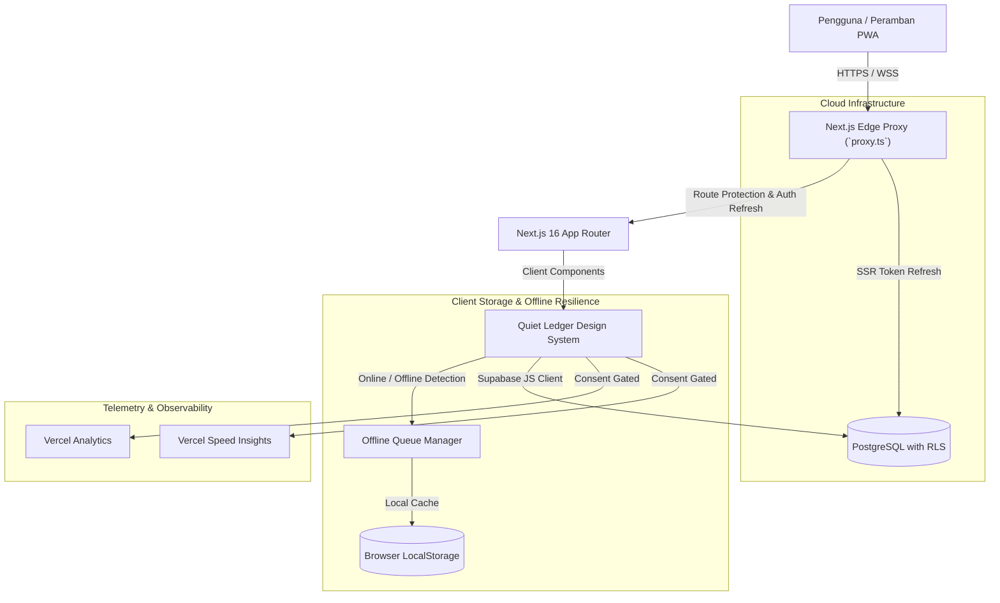
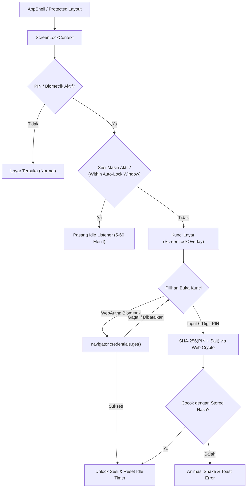
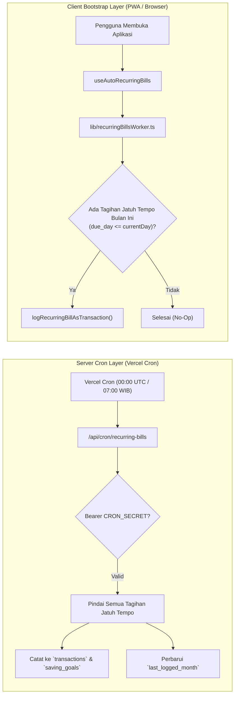

# Cukupin™: Technical Architecture & System Design Documentation

Dokumentasi arsitektur teknis, pola rekayasa perangkat lunak, dan infrastruktur data untuk aplikasi **Cukupin™**.

---

## 1. Ikhtisar Sistem (High-Level Architecture)

Cukupin™ dirancang menggunakan arsitektur modern berbasis **Next.js 16 (App Router)** dengan pendekatan *hybrid offline-first* dan integrasi cloud **Supabase (PostgreSQL)**.



---

## 2. Lapisan Keamanan & Edge Shielding (OWASP Standards)

### 2.1. HTTP Security Headers
Dikonfigurasi secara terpusat pada `next.config.mjs`:
- **Strict-Transport-Security (HSTS)**: `max-age=63072000; includeSubDomains; preload` (memaksa HTTPS selama 2 tahun).
- **Content-Security-Policy (CSP)**: Membatasi eksekusi skrip ke domain terpercaya (`'self'`, `'unsafe-inline'`, `https://va.vercel-scripts.com`, `https://vitals.vercel-insights.com`).
- **X-Frame-Options**: `DENY` untuk mencegah serangan Clickjacking.
- **X-Content-Type-Options**: `nosniff` untuk mencegah serangan MIME-type sniffing.
- **Referrer-Policy**: `strict-origin-when-cross-origin`.
- **Information Leakage**: `poweredByHeader: false` menghapus header identifikasi Next.js.

### 2.2. Edge Proxy Protection (`proxy.ts` - Next.js 16+ Convention)
- Memvalidasi dan memperbarui sesi autentikasi Supabase secara transparan pada edge runtime sebelum rute halaman dirender.
- Melindungi rute `/(protected)` (`/dashboard`, `/transactions`, `/reports`, `/goals`, `/wishlist`) dengan pengalihan otomatis ke `/auth/login` bagi pengguna tanpa sesi aktif.
- Menyediakan bypass otomatis untuk pengujian dan lingkungan pengembangan offline (`localhost`).

### 2.3. Sanitasi Injeksi Formula CSV (OWASP CSV Injection)
- Fungsi `escapeCsvField` pada `lib/finance.ts` menetralkan karakter berbahaya (`=`, `+`, `-`, `@`, `\t`, `\r`) dengan menyisipkan prefiks tanda kutip tunggal (`'`) sebelum diekspor.
- Ekspor menggunakan Byte Order Mark UTF-8 (`\uFEFF`) dan *blob URL* dengan pembersihan memori otomatis (`URL.revokeObjectURL`).

### 2.4. Edge Rate Limiting & Throttling (`lib/rateLimit.ts` & `proxy.ts`)
- **Algoritma Sliding-Window**: Menggunakan pencatatan timestamp in-memory beresolusi tinggi tanpa dependensi eksternal, mencegah *boundary burst exploitation*.
- **Integrasi Edge Proxy**: Mencegat seluruh request `/api/*` di `proxy.ts` dan membatasi laju request per alamat IP klien.
- **Preset Kebijakan**:
  - `API_DEFAULT`: 60 request / 60 detik (Rute API publik).
  - `AUTH_STRICT`: 5 request / 60 detik (Mencegah serangan brute-force login).
  - `CRON_WEBHOOK`: 12 request / 60 detik (Mencegah spam pemicu cron worker).
- **Header Standar RFC**: Menghasilkan `X-RateLimit-Limit`, `X-RateLimit-Remaining`, `X-RateLimit-Reset`, dan `Retry-After` dengan response code `429 Too Many Requests`.

---

## 3. Infrastruktur Data & Disaster Recovery (Backup & Restore)

Cukupin™ menyediakan sistem pemulihan bencana terpusat pada `lib/backup.ts` untuk memastikan pengguna memiliki kendali penuh atas data mereka.

### 3.1. Spesifikasi Payload Cadangan v2.0
```typescript
interface BackupPayload {
  app: 'cukupin'
  version: '2.0'
  exported_at: string // ISO 8601
  record_counts: {
    transactions: number
    goals: number
    wishlist: number
    bills: number
    budgets: number
  }
  transactions: Transaction[]
  goals: SavingGoal[]
  wishlist: WishlistItem[]
  bills: RecurringBill[]
  budgets: CategoryBudget[]
}
```

### 3.2. Validasi Skema (Zod)
- Sebelum pemulihan data dilakukan, file JSON diverifikasi menggunakan Zod schema untuk memastikan tidak ada data korup atau manipulasi struktur.
- Mendukung kompatibilitas ke belakang (*backward compatibility*) dengan file cadangan versi v1.0.

### 3.3. Algoritma Pemulihan
- **Merge Mode**: Menggabungkan data cadangan dengan data yang sudah ada tanpa menimpa ID yang sama.
- **Replace Mode**: Mengosongkan data lama dan menggantikannya secara menyeluruh dengan data dari file cadangan.

---

## 4. Performa & Observabilitas (Web Vitals & Telemetry)

### 4.1. Code Splitting Dinamis
Komponen modal dan visualisasi berat dimuat secara dinamis melalui `next/dynamic`:
- `MonthlyExpenseTemplate` (ekspor PDF/CSV).
- `CsvImportModal` (pemrosesan file buku kas).
- `RestoreJsonModal` (pemulihan data).
- `FinancialWrappedModal` (generasi rapor grafis).
Hal ini mengurangi *First Contentful Paint (FCP)* dan *Total Blocking Time (TBT)* secara signifikan.

### 4.2. Render Memoization
- Komponen baris transaksi `TransactionRow` dioptimalkan dengan `React.memo`, mencegah render ulang beruntun pada daftar ribuan transaksi saat pengguna melakukan pencarian atau filter.

### 4.3. Pemantauan Web Vitals & Speed Insights
- `@vercel/speed-insights` terintegrasi bersama `@vercel/analytics`.
- **Privasi Terkendali (Consent-gated)**: Telemetri dan pelacakan performa otomatis dibatalkan (`return null` pada `beforeSend`) jika pengguna memilih opsi "Tolak" pada banner persetujuan cookie, mematuhi regulasi UU PDP No. 27/2022 dan GDPR.

---

## 5. Kepatuhan Hukum & Privasi Data

1. **Hak Penghapusan Data (Right to Erasure / UU PDP Pasal 39)**:
   - Fitur "Hapus Seluruh Data Keuangan" pada menu Transaksi memberikan fasilitas *hard-delete* dengan konfirmasi ganda pengetikan kata kunci `HAPUS`.
2. **Pembersihan Sesi Logout**:
   - Logout membersihkan antrean sinkronisasi offline (`cukupin_offline_queue`) dan token otorisasi dari `localStorage`.

---

## 6. Sistem Keamanan Layar & Kriptografi Biometrik / PIN (`lib/security/`)

Untuk melindungi privasi keuangan pengguna saat PWA dibuka di perangkat bersama (*shared mobile/desktop devices*), Cukupin™ mengimplementasikan lapisan keamanan layar lokal:



### 6.1. Kriptografi Salted SHA-256 (Web Crypto API)
- Menggunakan `window.crypto.subtle` bawaan browser standar W3C.
- Setiap pembuatan/perubahan PIN menghasilkan **salt unik acak 16-byte** (`crypto.getRandomValues(new Uint8Array(16))`).
- Salt digabungkan dengan PIN numerik 6 digit sebelum di-hash menggunakan algoritma SHA-256.
- Hash dan salt disimpan secara lokal (`cukupin_screen_lock_hash`, `cukupin_screen_lock_salt`). PIN mentah (plaintext) **tidak pernah disimpan** di disk maupun memori jangka panjang.

### 6.2. Integrasi WebAuthn (Touch ID, Face ID, Windows Hello)
- Memanfaatkan platform authenticator bawaan (`PublicKeyCredential.isUserVerifyingPlatformAuthenticatorAvailable()`).
- Jika perangkat mendukung biometrik dan pengguna mengaktifkannya, verifikasi biometrik dapat dipicu dengan satu klik tanpa memasukkan 6 digit PIN.
- PIN 6 digit selalu menjadi opsi pemulihan utama (*fallback*) jika otentikasi biometrik gagal atau dibatalkan.

### 6.3. Manajemen Auto-Lock & Idle Timeout
- Pengguna dapat memilih interval auto-lock: Segera (`immediately`), 5 menit, 15 menit, 30 menit, atau 60 menit.
- Aktivitas pengguna dipantau melalui interaksi DOM (`mousemove`, `mousedown`, `keydown`, `touchstart`, `scroll`) yang memperbarui timestamp `cukupin_screen_lock_last_active`.

---

## 7. Arsitektur Automasi Tagihan Rutin (Dual-Layer Worker)

Untuk memastikan tagihan rutin tercatat tepat waktu setiap tanggal jatuh tempo tanpa membebani server atau membutuhkan aplikasi terus terbuka di latar belakang:



### 7.1. Deduping, Idempotency & Keamanan Cron
- Menggunakan kolom `last_logged_month` (format `YYYY-MM`) pada tabel `recurring_bills`.
- Tagihan yang sudah tercatat pada bulan berjalan **tidak akan pernah dicatat ulang**, baik oleh Server Cron maupun Client Worker.
- **Pengerasan Autorisasi Produksi**: Pada environment produksi (`NODE_ENV === 'production'`), konfigurasi `CRON_SECRET` bersifat wajib (*mandatory*). Permintaan tanpa bearer token yang valid ditolak dengan status `401 Unauthorized` atau `500 Misconfigured`.
- **Throttling Khusus Webhook**: Rute dibatasi maksimal 12 request per 60 detik (`RATE_LIMIT_PRESETS.CRON_WEBHOOK`) untuk mencegah eksekusi berulang yang tidak diinginkan.

### 7.2. Bridging Otomatis ke Target Tabungan (`saving_goals`)
- Jika tagihan memiliki kategori `'Tabungan'` atau `'Investasi'`, sistem secara cerdas mencari target tabungan yang masih aktif dengan nama yang cocok (atau target tabungan aktif pertama).
- Mutasi pengeluaran dicatat ke `transactions`, dan saldo `current_amount` pada target tabungan tersebut otomatis bertambah secara atomik.

---

## 8. UX PWA & Pengendali Frekuensi Banner Install

Untuk mencegah gangguan navigasi saat berpindah-pindah halaman, banner instalasi PWA diatur dengan jeda frekuensi 7 hari:
- **Immediate Timestamp Recording**: Saat banner ditampilkan pertama kali, timestamp `cukupin_install_prompt_last_shown_at` langsung dicatat ke `localStorage`.
- **7-Day Cooldown Window**: Banner ditekan dan tidak akan muncul kembali selama minimal 7 hari (168 jam) sejak terakhir kali tampil atau ditolak.
- **Deteksi Mode Terpasang**: Jika aplikasi sudah berjalan dalam mode standalone PWA (`window.matchMedia('(display-mode: standalone)').matches`), banner secara permanen dinonaktifkan.

---

## 9. Indeks Dokumentasi Sistem Lengkap

Untuk panduan mendalam lainnya, silakan merujuk ke pustaka dokumentasi resmi di folder `docs/`:
- [**DATABASE_SCHEMA.md**](./DATABASE_SCHEMA.md) — Diagram ERD, spesifikasi tabel, RLS, indeks performa, & publikasi realtime.
- [**SECURITY_AUDIT.md**](./SECURITY_AUDIT.md) — Pemodelan ancaman (STRIDE), mitigasi OWASP Top 10, CSP, & kepatuhan UU PDP.
- [**API_AND_DATA_FLOW.md**](./API_AND_DATA_FLOW.md) — Arsitektur alur data, antrean offline-first, backup payload v2.0, & pipeline CSV.
- [**DEVELOPER_GUIDE.md**](./DEVELOPER_GUIDE.md) — Panduan onboarding developer, setup lokal tanpa Supabase, TDD Vitest, & konvensi kode.
- [**SUPABASE_DEPLOYMENT.md**](./SUPABASE_DEPLOYMENT.md) — Panduan migrasi database 1-klik, penyelesaian preview branching, dan konfigurasi produksi.
- [**RESOURCES.md**](./RESOURCES.md) — Panduan alokasi sumber daya Vercel & Supabase, batas free tier, dan strategi mitigasi bottleneck.
- [**BENCHMARK.md**](./BENCHMARK.md) — Tolok ukur empiris ukuran payload data, simulasi matematis egress, dan batas timeout 10 detik.
- [**LOAD_TESTING.md**](./LOAD_TESTING.md) — Panduan uji beban k6, skenario stres/lonjakan (spike), mitigasi DDoS, dan runner Node.js.


