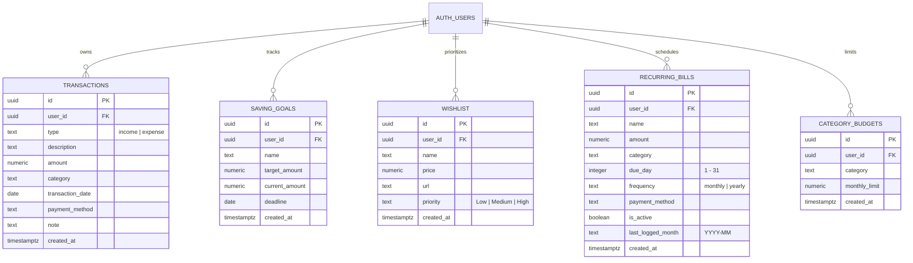

# Cukupin™ Database Architecture & Schema Specification

Dokumentasi resmi arsitektur basis data, Entity-Relationship Diagram (ERD), aturan Row Level Security (RLS), indeks performa, dan konfigurasi replikasi real-time untuk aplikasi Cukupin™.

---

## 1. Entity-Relationship Diagram (ERD)

Arsitektur database Cukupin™ mengadopsi model multi-tenant berbasis `auth.users(id)` dari Supabase Engine. Setiap record data terikat erat pada akun pengguna terautentikasi melalui foreign key `user_id` dengan aksi cascading delete (`ON DELETE CASCADE`).



---

## 2. Rincian Tabel & Skema Kolom

### 2.1. Tabel `public.transactions`
Menyimpan mutasi keuangan harian (pemasukan & pengeluaran).

| Kolom | Tipe Data | Nullable | Default | Batasan / Constraint |
| :--- | :--- | :--- | :--- | :--- |
| `id` | `uuid` | NOT NULL | `gen_random_uuid()` | Primary Key |
| `user_id` | `uuid` | NOT NULL | - | Foreign Key -> `auth.users(id)` ON DELETE CASCADE |
| `type` | `text` | NOT NULL | - | `check (type in ('income', 'expense'))` |
| `description` | `text` | NOT NULL | - | `check (char_length(description) between 1 and 120)` |
| `amount` | `numeric(12,2)` | NOT NULL | - | `check (amount > 0)` |
| `category` | `text` | NOT NULL | - | `check (char_length(category) between 1 and 40)` |
| `transaction_date` | `date` | NOT NULL | `current_date` | Format ISO `YYYY-MM-DD` |
| `payment_method` | `text` | NULL | NULL | Misal: 'Tunai', 'BCA', 'GoPay', dsb. |
| `note` | `text` | NULL | NULL | Catatan opsional & tag `#tag` |
| `created_at` | `timestamptz` | NOT NULL | `now()` | Waktu pembuatan record |

### 2.2. Tabel `public.saving_goals`
Menyimpan target tabungan dan progres alokasi dana pengguna.

| Kolom | Tipe Data | Nullable | Default | Batasan / Constraint |
| :--- | :--- | :--- | :--- | :--- |
| `id` | `uuid` | NOT NULL | `gen_random_uuid()` | Primary Key |
| `user_id` | `uuid` | NOT NULL | - | Foreign Key -> `auth.users(id)` ON DELETE CASCADE |
| `name` | `text` | NOT NULL | - | `check (char_length(name) between 1 and 80)` |
| `target_amount` | `numeric(12,2)` | NOT NULL | - | `check (target_amount > 0)` |
| `current_amount` | `numeric(12,2)` | NOT NULL | `0` | `check (current_amount >= 0 and current_amount <= target_amount)` |
| `deadline` | `date` | NULL | NULL | Target tanggal penyelesaian |
| `created_at` | `timestamptz` | NOT NULL | `now()` | Waktu pembuatan record |

### 2.3. Tabel `public.wishlist`
Daftar barang impian untuk mencegah belanja impulsif dengan sistem delay & prioritas.

| Kolom | Tipe Data | Nullable | Default | Batasan / Constraint |
| :--- | :--- | :--- | :--- | :--- |
| `id` | `uuid` | NOT NULL | `gen_random_uuid()` | Primary Key |
| `user_id` | `uuid` | NOT NULL | - | Foreign Key -> `auth.users(id)` ON DELETE CASCADE |
| `name` | `text` | NOT NULL | - | `check (char_length(name) between 1 and 100)` |
| `price` | `numeric(12,2)` | NOT NULL | - | `check (price > 0)` |
| `url` | `text` | NULL | NULL | Tautan toko online |
| `priority` | `text` | NOT NULL | `'Medium'` | `check (priority in ('Low', 'Medium', 'High'))` |
| `created_at` | `timestamptz` | NOT NULL | `now()` | Waktu penambahan |

### 2.4. Tabel `public.recurring_bills`
Pengeluaran rutin bulanan atau tahunan (listrik, internet, sewa tempat, langganan).

| Kolom | Tipe Data | Nullable | Default | Batasan / Constraint |
| :--- | :--- | :--- | :--- | :--- |
| `id` | `uuid` | NOT NULL | `gen_random_uuid()` | Primary Key |
| `user_id` | `uuid` | NOT NULL | - | Foreign Key -> `auth.users(id)` ON DELETE CASCADE |
| `name` | `text` | NOT NULL | - | `check (char_length(name) between 1 and 120)` |
| `amount` | `numeric(12,2)` | NOT NULL | - | `check (amount > 0)` |
| `category` | `text` | NOT NULL | - | `check (char_length(category) between 1 and 40)` |
| `due_day` | `integer` | NOT NULL | - | `check (due_day between 1 and 31)` |
| `frequency` | `text` | NOT NULL | `'monthly'` | `check (frequency in ('monthly', 'yearly'))` |
| `payment_method` | `text` | NULL | `'Transfer Bank'` | Metode bayar terjadwal |
| `is_active` | `boolean` | NOT NULL | `true` | Status aktif/tidaknya tagihan |
| `last_logged_month` | `text` | NULL | NULL | Pelacak eksekusi bulan terakhir (contoh: `'2026-09'`) |
| `created_at` | `timestamptz` | NOT NULL | `now()` | Waktu pembuatan |

### 2.5. Tabel `public.category_budgets`
Batas maksimal (limit) pengeluaran per kategori per bulan untuk mencegah overspending.

| Kolom | Tipe Data | Nullable | Default | Batasan / Constraint |
| :--- | :--- | :--- | :--- | :--- |
| `id` | `uuid` | NOT NULL | `gen_random_uuid()` | Primary Key |
| `user_id` | `uuid` | NOT NULL | - | Foreign Key -> `auth.users(id)` ON DELETE CASCADE |
| `category` | `text` | NOT NULL | - | `check (char_length(category) between 1 and 40)` |
| `monthly_limit` | `numeric(12,2)` | NOT NULL | - | `check (monthly_limit > 0)` |
| `created_at` | `timestamptz` | NOT NULL | `now()` | Waktu pembuatan |
| *(Unique Constraint)* | - | - | - | `UNIQUE (user_id, category)` |

---

## 3. Row Level Security (RLS) & Kebijakan Akses

Semua tabel memiliki `ENABLE ROW LEVEL SECURITY`. Tidak ada pengguna yang dapat melihat, menambah, mengubah, atau menghapus data milik pengguna lain.

Prinsip evaluasi: `(select auth.uid()) = user_id`

```sql
-- Contoh Kebijakan Isolasi Data (Penyewa Tunggal / Tenant Isolation)
ALTER TABLE public.transactions ENABLE ROW LEVEL SECURITY;
CREATE POLICY "Users manage their transactions" 
  ON public.transactions 
  FOR ALL 
  TO authenticated 
  USING ((select auth.uid()) = user_id) 
  WITH CHECK ((select auth.uid()) = user_id);
```

Kebijakan identik diterapkan pada:
- `public.saving_goals` (Select, Insert, Update, Delete)
- `public.wishlist` (Select, Insert, Update, Delete)
- `public.recurring_bills` (Select, Insert, Update, Delete)
- `public.category_budgets` (Select, Insert, Update, Delete)

---

## 4. Indeks Performa & Optimasi Kueri

Indeks dibangun berdasarkan pola kueri dominan di aplikasi untuk memastikan waktu respons sub-milidetik:

1. **`transactions_user_date_idx`** on `(user_id, transaction_date desc)`:
   - Mempercepat pengambilan daftar transaksi terurut tanggal dan penyaringan rentang waktu bulanan.
2. **`transactions_user_category_idx`** on `(user_id, category)`:
   - Mengoptimalkan agregasi diagram donat pengeluaran dan laporan bulanan 50/30/20.
3. **`transactions_user_type_date_idx`** on `(user_id, type, transaction_date desc)`:
   - Mempercepat tabulasi terpisah antara arus kas Pemasukan vs Pengeluaran.
4. **`transactions_user_payment_method_idx`** on `(user_id, payment_method)`:
   - Mempercepat filtering transaksi berdasarkan rekening / dompet digital.
5. **`saving_goals_user_deadline_idx`** on `(user_id, deadline asc nulls last)`:
   - Menghasilkan daftar target tabungan yang mendekati jatuh tempo dengan efisien.
6. **`wishlist_user_priority_idx`** on `(user_id, priority, created_at desc)`:
   - Mempercepat sortir prioritas wishlist (High -> Medium -> Low).
7. **`recurring_bills_due_day_idx`** on `(user_id, due_day)`:
   - Mempercepat deteksi tagihan yang jatuh tempo hari ini atau pekan ini.
8. **`category_budgets_user_cat_idx`** on `(user_id, category)`:
   - Mempercepat lookup pagu anggaran saat transaksi baru dicatat.

---

## 5. Replikasi Supabase Real-Time

Tabel diaktifkan untuk replikasi penuh dengan `REPLICA IDENTITY FULL` agar setiap perubahan (INSERT, UPDATE, DELETE) dikirimkan secara langsung melalui WebSocket kepada klien aktif:

```sql
ALTER TABLE public.transactions REPLICA IDENTITY FULL;
ALTER TABLE public.saving_goals REPLICA IDENTITY FULL;
ALTER TABLE public.wishlist REPLICA IDENTITY FULL;
ALTER TABLE public.recurring_bills REPLICA IDENTITY FULL;
ALTER TABLE public.category_budgets REPLICA IDENTITY FULL;

DO $$ BEGIN
  ALTER PUBLICATION supabase_realtime ADD TABLE public.transactions;
  ALTER PUBLICATION supabase_realtime ADD TABLE public.saving_goals;
  ALTER PUBLICATION supabase_realtime ADD TABLE public.wishlist;
  ALTER PUBLICATION supabase_realtime ADD TABLE public.recurring_bills;
  ALTER PUBLICATION supabase_realtime ADD TABLE public.category_budgets;
EXCEPTION WHEN OTHERS THEN NULL; END $$;
```

---

## 6. Riwayat Migrasi SQL

Seluruh migrasi disimpan dalam folder `supabase/migrations/`:

1. **`20260905000000_cukupin.sql`**:
   - Inisialisasi tabel dasar: `transactions`, `saving_goals`, `wishlist`.
   - Setup RLS dasar dan publikasi realtime idempotent.
2. **`20260905000001_performance_and_realtime.sql`**:
   - Pembuatan composite index kategori dan tipe transaksi.
   - Pendaftaran `saving_goals` dan `wishlist` ke realtime publication.
3. **`20260905000002_add_payment_method.sql`**:
   - Penambahan kolom `payment_method` pada `transactions`.
   - Indeks komposit `transactions_user_payment_method_idx`.
4. **`20260906000003_recurring_bills_and_budgets.sql`**:
   - Penambahan tabel `recurring_bills` dan `category_budgets`.
   - RLS, unique constraint, indeks tanggal jatuh tempo, dan pendaftaran realtime.
5. **`full_schema.sql` (Consolidated Idempotent Production Script v2.0)**:
   - Skrip konsolidasi lengkap yang menggabungkan seluruh migrasi ke dalam satu berkas terpadu.
   - Bersifat 100% idempoten (`CREATE TABLE IF NOT EXISTS`, `CREATE INDEX IF NOT EXISTS`, dan blok `DO $$`), siap dieksekusi dengan satu klik di Supabase SQL Editor tanpa risiko menimpa atau merusak data yang telah ada.
   - Tersinkronisasi penuh dengan antarmuka TypeScript pada [`lib/database.types.ts`](../lib/database.types.ts).
